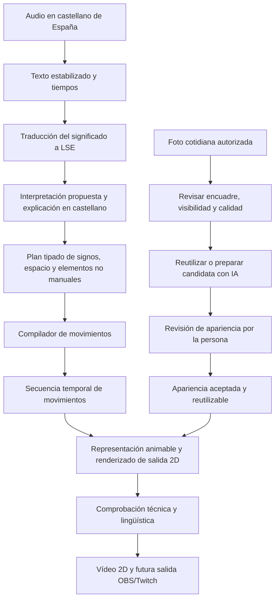

# Arquitectura acordada — 26 de noviembre de 2026

Esta especificación define el sistema que se quiere construir. Primero se diseña la representación lingüística y de movimientos; la reproducción visual se evalúa por separado. Las capacidades pendientes no se presentan como implementadas.

Actualización de viabilidad de directo: [DIRECTO.md](DIRECTO.md). En Twitch la ruta prioritaria es animar una representación preparada; la generación por difusión de vídeos completos se considera un ensayo offline de apariencia. La personalización realista desde una foto para esa ruta interactiva sigue sin resolver. No presentar MimicMotion como backend de directo ni el presupuesto cero como disponibilidad gratuita garantizada.

## Flujo de uso

La LSE es la lengua de destino. Ni un modelo entrenado con otra lengua de signos ni un diccionario palabra-signo resuelven por sí solos la traducción. No se exige un personaje 3D visible ni trabajo de modelado manual. Una representación 3D interna puede conservar profundidad, orientación y contactos; no determina la estética final.

## Preparación de apariencia, una vez por referencia

La entrada habitual es una foto cotidiana. El proceso evalúa si puede reutilizarse o necesita preparación con IA; no exige una foto perfecta al usuario. Sigue [PREPARACION_FOTOS.md](PREPARACION_FOTOS.md), conserva original y reconstrucciones, y obtiene aceptación explícita de apariencia antes de animar. Esta rama se realiza al crear/cambiar referencia y se reutiliza después; no se regenera en cada mensaje. El gestor privado y el prompt están implementados; la evaluación/edición se realiza actualmente con el asistente y imagegen, sin integración automática desde una aplicación de subida de fotos.

## 1. Audio → texto

Reconocer castellano de España, con segmentos y marcas temporales. Registrar incertidumbre y revisiones de la transcripción. Traducir unidades con contexto suficiente, no cada palabra provisional. Medir el retraso de estabilización antes de prometer funcionamiento en directo. La primera versión usa texto para aislar el problema de LSE.

## 2. Texto → representación lingüística de LSE

Usar el significado y contexto del mensaje para elegir signos, variantes, organización, referencias espaciales, direcciones y elementos no manuales. Diccionarios aportan evidencia léxica; traducciones y vídeos continuos ayudan con estructura y uso contextual. Las glosas son identificadores parciales, no una descripción completa de la lengua.

Las traducciones existentes de LSE a castellano son material paralelo útil, pero invertir sus pares no garantiza automáticamente una traducción correcta en la dirección contraria. Revisar anotaciones especiales, segmentación y correspondencia de significado.

## Ampliación propuesta: instrucciones legibles y glosario

La propuesta de [GLOSARIO.md](GLOSARIO.md) añade una explicación en castellano de cómo representar la frase y un inventario de signos/construcciones, descripciones, evidencias y realizaciones. Esta explicación se acompaña de un plan estructurado; un compilador transforma IDs y parámetros conocidos en comandos. No se ejecuta prosa libre ni código generado por la IA. Inicialmente puede usarse una sola llamada para proponer el plan, con descripción ejecutiva derivada de sus campos, evitando una segunda inferencia de conversión.

El motor conserva la distinción entre propuestas de IA, observaciones y recursos revisados. La existencia de diccionarios o transcripciones no completa automáticamente configuraciones, boca, contactos y transiciones ausentes. Esta ampliación no está implementada; la extracción actual sigue siendo observación geométrica.

## 3. Representación lingüística → movimientos

Planificar ambas manos: configuración de dedos, posición, orientación, trayectoria, contactos, mano dominante y coordinación. Incluir brazos, cabeza, cuerpo, mirada, cejas, boca y transiciones entre signos, con duración y coordinación entre canales.

La boca sigue lo que requiere la LSE: componentes labiales relacionados con palabras y gestos bucales cuando procedan. No imponer sincronización fonema a fonema con la voz castellana. No fijar una secuencia universal por palabra: variantes y ejecución dependen del contexto.

## Contrato intermedio propuesto

Formato interno versionado, independiente del traductor y generador. La primera implementación es el [contrato 0.1 de observaciones](CONTRATO.md): exporta y comprueba evidencia de los tres fragmentos, con los campos de movimiento ausentes. No hay todavía contrato ejecutable de planes lingüísticos nuevos ni de secuencias listas para renderizar. Bloques del diseño completo:

| Bloque | Información mínima |
|---|---|
| Entrada | ID del mensaje, texto, idioma de origen, contexto pertinente y tiempos disponibles. |
| Plan lingüístico | Unidades de significado, referencias espaciales, identificadores de signos, variantes, dirección y anotaciones no manuales. |
| Movimiento | Sistema de coordenadas, unidades y articulaciones; posiciones/orientaciones, canales faciales y tiempos relativos monótonos. No mezclar coordenadas incompatibles. |
| Evidencia | Fuente, versión, intervalo de vídeo y condiciones de uso de cada ejemplo o anotación. |
| Estado | Propuesto, estimado, revisado o rechazado; campos desconocidos explícitos y revisiones pendientes. Una confianza numérica no equivale a validación. |

Separar el plan lingüístico simbólico de la secuencia de articulaciones. Una estimación de poses procedente de un vídeo es una observación con posibles errores, no un plan lingüístico validado. El generador debe aceptar una secuencia y una apariencia sin cambiar el significado planificado.

## 4. Movimientos → persona en vídeo

Evaluar un generador ya existente. La apariencia empieza fija; la personalización se prueba después sobre una secuencia validada. No se promete que baste una fotografía ni que el generador siga de forma exacta todas las articulaciones. Una guía por puntos puede ser una condición aproximada, no una restricción dura.

Performs/Animics son candidatos opcionales para preparar, inspeccionar o reproducir movimiento. Pose-to-Video es candidato para apariencia fotorrealista. Ninguno se ha integrado ni validado para el objetivo completo; comprobar código, pesos y recursos por separado antes de instalar.

## Preparación de datos y aprendizaje

- Mantener fuentes y material original autorizados separados de las derivaciones. Inventariar vídeo, traducción, intervalos, anotaciones y permisos antes de entrenar.
- Revisar visibilidad de manos y rostro, oclusiones, resolución, variantes y contexto. No convertir audio transcrito en traducción de referencia de LSE sin revisión.
- Construir un repertorio de ejemplos y, si es adecuado, aprender modelos por etapas. Definir primero objetivos, datos, evaluación y recursos; entrenamiento desde cero no es el punto de partida.
- Separar personas/contenidos entre entrenamiento y evaluación. Mantener casos no vistos y versiones de datos para evitar filtración.
- El código propio es MIT; los corpus conservan sus condiciones. No redistribuir automáticamente vídeos, traducciones, poses o pesos derivados. La aparición pública de una persona no autoriza clonarla.

## Evaluación y participación de Eva

Eva revisa objetivos, interfaz y apariencia. No se le pide certificar signos que no conoce. Sus valoraciones visuales no se convierten en validación lingüística.

La revisión técnica comprueba geometría, continuidad, contactos, sincronización y fidelidad al movimiento de referencia. La comprensión, gramática y equivalencia del significado requieren personas sordas signantes competentes y especialistas de LSE. Registrar cada revisión por separado y no declarar el sistema validado si falta alguna.

Los tres originales descargados no tienen pista de audio, comprobado con AVFoundation. Su traducción escrita es una referencia, no una locución. Subtítulos o voz sintética podrían ayudar a seguir el contenido; no prueban la corrección de LSE.

## Alcance inicial y recursos

Primer entregable de diseño: inventario de evidencia y contrato intermedio. Primer ensayo futuro: texto breve → plan revisado → movimientos → vídeo, con los fallos visibles. No inventar ahora glosas, posiciones o traducciones como si estuvieran validadas.

Los tres vídeos ya descargados sirven como banco inicial de observación, no como prueba de traducción implementada. No ampliar el lote, cargar modelos, activar GPU o contratar entrenamiento por esta especificación. Procesamiento secuencial; recursos medidos y presupuesto antes de inferencias. Datos y resultados siguen locales.

Después de verificar por separado traducción y apariencia, incorporar voz, personalización e integración OBS/Twitch. El procesamiento del micrófono requiere acceso autorizado del emisor; la API de Twitch no se presupone un endpoint general de audio. Medir latencia y recursos de la cadena completa antes de prometer tiempo real.
